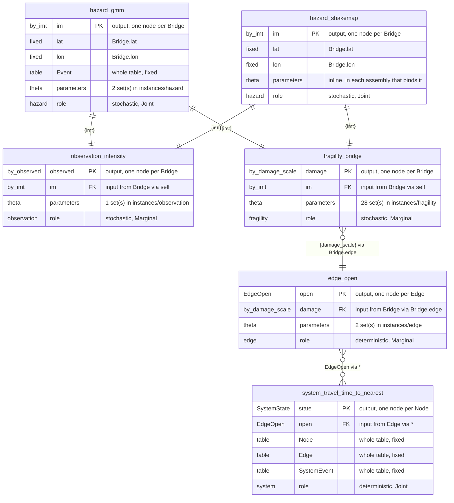
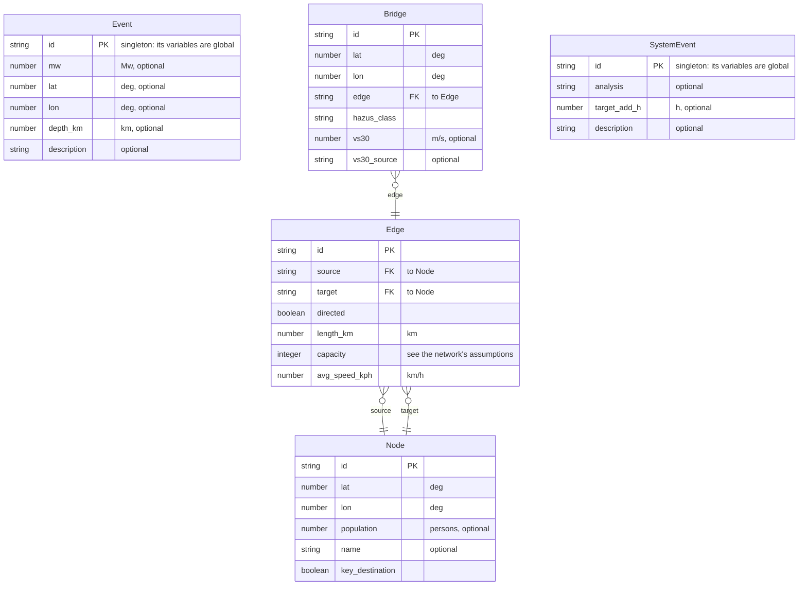

# Schema diagram

<!-- Generated by `python -m src diagram` from schema/*.json; edit those, not this. The tests fail if it is stale. -->

6 functions, 5 plates and 9 quantities. GitHub draws the diagrams below; in VS Code the Markdown preview needs a Mermaid extension. [`diagram.html`](diagram.html), beside this file, draws the same schema interactively: open it in a browser.

## Functions: what can connect to what

Each function is a table. Its output (PK) is the BN node it defines, one per row of its plate; its inputs (FK) are the nodes it reads. A link joins an output to every input of the same quantity on the same plate; where several hazard functions feed one input, they are alternatives, and an assembly binds one.

Link ends, producer left, consumer right: `||--||` one parent, the same row · `||--o{` many nodes share one parent · `}o--||` many parents per node · `}o--o{` every node of the plate is a parent.

## Plates: the tables functions are replicated over

Attributes are fixed data, never BN nodes. Foreign keys are what an input's `via` follows.

## Quantities: the types on the links

| Quantity | Kind | Unit or states | Meaning | Used by |
|---|---|---|---|---|
| `PGA` | continuous | g | Peak ground acceleration | `fragility.bridge (in)`, `hazard.gmm (out)`, `hazard.shakemap (out)` |
| `PGV` | continuous | cm/s | Peak ground velocity | `fragility.bridge (in)`, `hazard.gmm (out)`, `hazard.shakemap (out)` |
| `SA(0.3)` | continuous | g | Spectral acceleration, T = 0.3 s, 5% damping | `fragility.bridge (in)`, `hazard.gmm (out)`, `hazard.shakemap (out)` |
| `SA(1.0)` | continuous | g | Spectral acceleration, T = 1.0 s, 5% damping | `fragility.bridge (in)`, `hazard.gmm (out)`, `hazard.shakemap (out)`, `observation.intensity (in)` |
| `SA(3.0)` | continuous | g | Spectral acceleration, T = 3.0 s, 5% damping | `fragility.bridge (in)`, `hazard.gmm (out)`, `hazard.shakemap (out)` |
| `SAObs(1.0)` | continuous | g | Observed spectral acceleration, T = 1.0 s, 5% damping | `observation.intensity (out)` |
| `DamageState.HazusBridge` | discrete | none, slight, moderate, extensive, complete | Hazus highway-bridge damage state | `edge.open (in)`, `fragility.bridge (out)` |
| `EdgeOpen` | discrete | False, True | Edge open to traffic | `edge.open (out)`, `system.travel-time-to-nearest (in)` |
| `SystemState` | discrete | Fail, Survival | System event survives | `system.travel-time-to-nearest (out)` |
